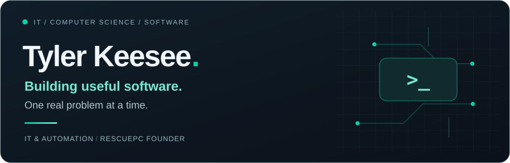
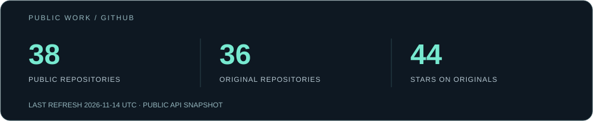

**Windows tools · Practical automation · Software that helps people**

[RescuePC ↗](https://www.rescuepcrepairs.com/) &nbsp; / &nbsp; [Selected work ↗](#selected-work) &nbsp; / &nbsp; [GitHub ↗](https://github.com/Tyler-Keesee)

## Hey, I'm Tyler.

I'm a developer, Computer Science student, and the founder of [RescuePC ↗](https://www.rescuepcrepairs.com/),  I build tools to make everyday technology easier to understand, maintain, and use.

My work starts with a practical problem: a PC that needs troubleshooting, a repetitive task that takes too long, or a concept that could be easier to learn. I like turning those problems into software people can actually use.

**Explore:** [Selected work](#selected-work) · [My toolkit](#my-toolkit) · [What drives me](#what-drives-me) · [On GitHub](#on-github) · [Connect](#lets-connect)

## Selected work

<table>
<tr>
<td width="50%" valign="top">

### 🛠️ RescuePC

Proprietary Windows repair software for diagnostics, driver management, security scanning, and system maintenance. The product behind my business; source code is private.

**Windows · PowerShell · Automation**

[Explore RescuePC ↗](https://www.rescuepcrepairs.com/)

</td>
<td width="50%" valign="top">

### 📡 Hardware Analyzer Pro

A desktop hardware monitor for CPU, memory, GPU, storage, and network metrics, with live graphs and export tools.

**Python · PyQt6 · System monitoring**

[Explore the code ↗](https://github.com/Tyler-Keesee/Hardware-Analyzer-Pro)

</td>
</tr>
<tr>
<td width="50%" valign="top">

### 🧠 PyLearn IDE

A browser-based Python learning environment with an editor, interactive console, and visual tools for exploring programming concepts.

**JavaScript · Brython · Learning tools**

[Explore the code ↗](https://github.com/Tyler-Keesee/PyLearn-IDE)

</td>
<td width="50%" valign="top">

### ⚙️ Engineering & Automation

A collection of developer tools, software experiments, and practical automation projects. Explore the code and see what I'm building and learning.

**Python · TypeScript · Go · PowerShell**

[Explore my repositories ↗](https://github.com/Tyler-Keesee?tab=repositories)

</td>
</tr>
</table>

[Browse all public repositories →](https://github.com/Tyler-Keesee?tab=repositories)

## My toolkit

| Area | Languages & tools |
| :--- | :--- |
| Desktop & automation | Python, PowerShell, Windows, PyQt6 |
| Web | JavaScript, TypeScript, HTML, CSS |
| Development | Git, GitHub, VS Code, Vercel |
| Exploring & learning | C, C++, Java, Linux, computer science fundamentals |

## What drives me

- **Useful tools.** Build around real troubleshooting and workflow problems.
- **Thoughtful engineering.** Keep improving reliability, performance, and security.
- **Learning by doing.** Connect Computer Science coursework with hands-on projects.
- **Building a business.** Keep developing RescuePC alongside work and school.

## On GitHub

<!-- STATS:START -->
**50 public repositories · 47 original repositories · 56 stars on originals**  
Updated 2026-11-14 (UTC).
<!-- STATS:END -->

Daily snapshot from GitHub's public API. Stars are counted across original public repositories; forks are excluded from that total. The date above shows the last successful refresh. [How it updates](docs/profile-maintenance.md).

## Professional links

Interested in the projects or software featured here? Explore the source repositories or visit RescuePC for product information.

**[GitHub repositories](https://github.com/Tyler-Keesee?tab=repositories)** · **[RescuePC](https://www.rescuepcrepairs.com/)****

---

Build with purpose. Learn by doing. Keep making it better.

